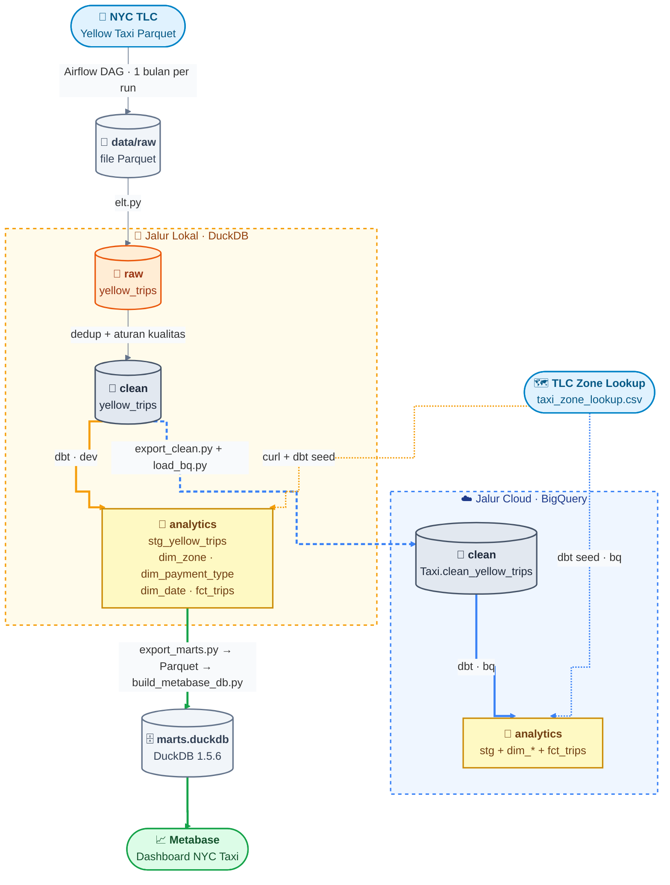
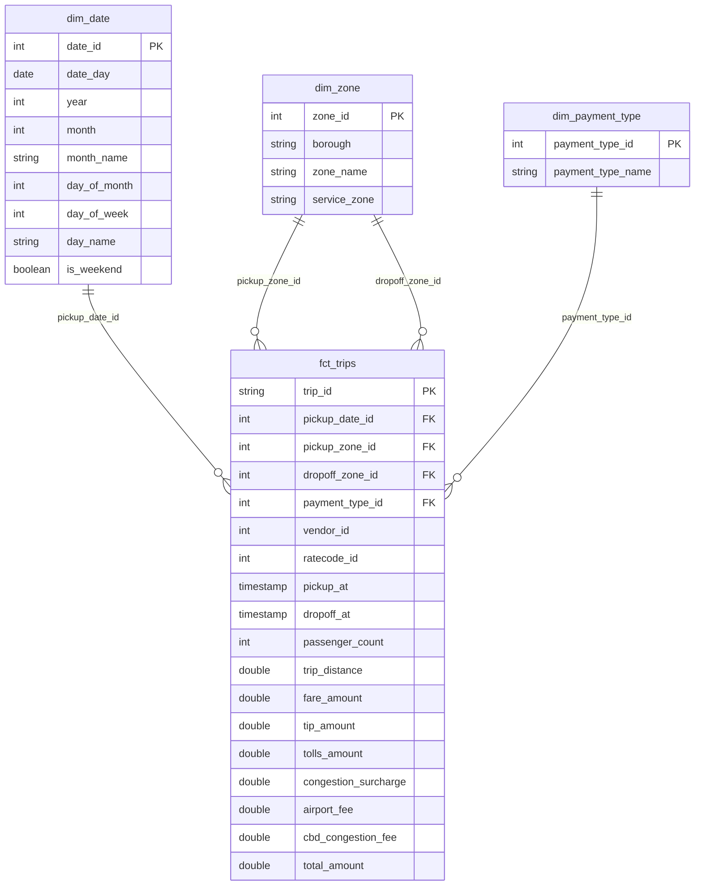

# Architecture: NYC Taxi ELT

Data flows from the NYC TLC public files to a Metabase dashboard.
The same dbt models run on two engines: DuckDB (local) and BigQuery sandbox (cloud).

## Pipeline flow

## Star schema

## Layers and why a re-run is safe

| Layer | Where | Re-run behavior |
|---|---|---|
| Download | Airflow DAG `download_tlc_yellow` | Skips a file that exists. Temp file, then rename |
| raw | DuckDB `raw.yellow_trips` | Deletes the month, inserts it again |
| clean | DuckDB `clean.yellow_trips` | Deletes the month, inserts it again |
| analytics | dbt (DuckDB or BigQuery) | dbt rebuilds the tables |
| BigQuery `Taxi.clean_yellow_trips` | `load_bq.py` | First file truncates the table, the rest append |
| Metabase file | `build_metabase_db.py` | Deletes the file, builds it again |

## Scripts

| Script | Role |
|---|---|
| `dags/download_tlc_yellow.py` | Airflow DAG, downloads one month of Parquet |
| `scripts/local/elt.py` | Loads raw, builds clean (dedup and quality rules) |
| `scripts/local/profile.py`, `explore.py` | Look at the data before writing rules |
| `scripts/local/export_marts.py` | Copies the marts into `marts.duckdb` |
| `scripts/local/export_marts_parquet.py` | Exports the marts to Parquet |
| `scripts/local/build_metabase_db.py` | Builds the Metabase file with DuckDB 1.5.6 |
| `scripts/bigquery/export_clean.py` | Exports `clean` to Parquet, one file per month |
| `scripts/bigquery/load_bq.py` | Loads the Parquet files into BigQuery |
| `scripts/bigquery/verify_bq.py`, `check_bq.py` | Compare row counts, check access |

## Notes

- Only the download step runs in Airflow. The other steps are manual scripts.
- The zone lookup CSV is downloaded with `curl` and loaded by `dbt seed`.
- Metabase needs a DuckDB file written by a matching DuckDB version (1.5.6), so it gets its own build step.
- BigQuery sandbox tables expire after 60 days, so that branch is always rebuilt from files.
